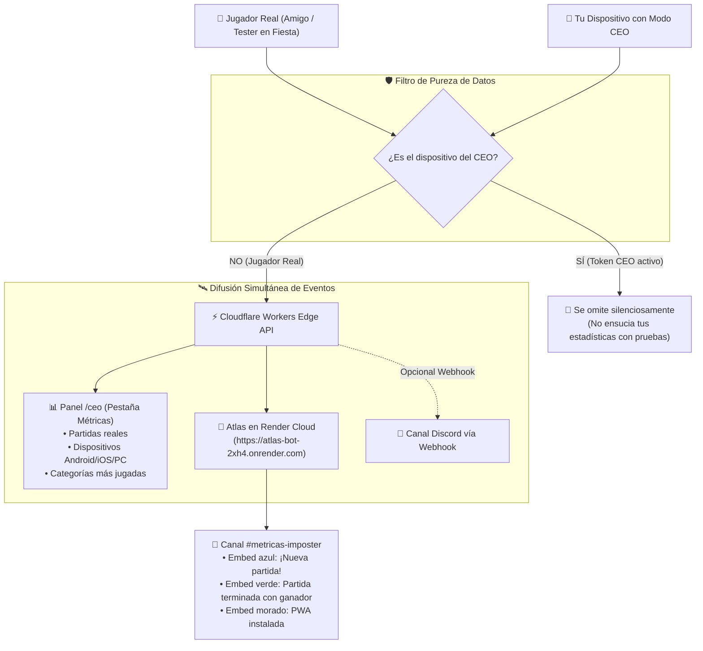

# 🧠 PROJECT BRAIN — PLANOS MAESTROS Y MANUAL DE VUELO DE IMPOSTER

> **Documento Oficial de Relevo Técnico y Arquitectura de Negocio**  
> **Para el CEO (L7Manuel) y cualquier Desarrollador o Inteligencia Artificial que trabaje en este proyecto.**  
> _Última actualización: Noviembre 2026 | Estado del Sistema: 100% Operativo en Producción._

---

## ⚡ 1. PROMPT DE ACTIVACIÓN INMEDIATA PARA CUALQUIER OTRA IA

_(Si en algún momento usas ChatGPT, Claude, DeepSeek, Google AI Studio o Cursor, copia y pega el siguiente bloque exacto en el primer mensaje junto a este archivo):_

```text
Actúa como el Desarrollador Principal y Arquitecto de Software de "Imposter".
He cargado el archivo PROJECT_BRAIN.md que contiene la arquitectura completa, las decisiones de negocio, las reglas intocables y el mapa de código del repositorio.

Por favor confirma que entiendes:
1. El stack: TanStack Start (SSR/React 19) + Cloudflare Workers + Vite + Nitro + Tailwind CSS.
2. La infraestructura auxiliar: Bot de Discord "Atlas" en Node.js desplegado en Render (Web Service).
3. La regla de oro de costos: Infraestructura $0 fijos mensuales (sin base de datos pesada).
4. El filtro de telemetría: El dispositivo del CEO está excluido de métricas y alertas en Discord.
5. Los comandos de despliegue: `npm run deploy` para Cloudflare Workers con `--name imposter`.

Dime que estás listo y cuál es el estado del proyecto para recibir mi primera instrucción.
```

---

## 🗺️ 2. EL MAPA DE LA CASA (DÓNDE VIVE CADA COSA)

Toda la aplicación está construida con código limpio, modular y tipado en TypeScript. Aquí está la ubicación exacta de cada engranaje:

```
Imposter/
├── bot/
│   └── index.js             # 🤖 Bot de Discord "Atlas" (Servidor Node en Render)
├── public/                  # 📱 Manifiesto PWA, iconos, offline.html, Service Worker
├── src/
│   ├── lib/
│   │   ├── payment-config.ts    # 💳 Precios de planes, cuentas Pago Móvil, wallet Binance
│   │   ├── coupon-server.ts     # 🎟️ Validación de cupones, RPC server functions y gestión de fundadores
│   │   ├── telemetry.ts         # 📊 Captura de eventos cliente (con filtro anti-CEO)
│   │   ├── telemetry-server.ts  # 🌐 Reenvío de métricas al bot y a Discord
│   │   ├── security.ts          # 🛡️ Criptografía HMAC, firmas FNDR, cupones y sanitización
│   │   ├── pwa-install.ts       # 📲 Lógica de instalación en pantalla de inicio (PWA)
│   │   └── wake-lock.ts         # 💡 Evita que la pantalla se apague durante el juego
│   ├── routes/
│   │   ├── index.tsx        # 🎮 CORAZÓN DEL JUEGO: UI de partida, Categorías Lucide, Escáner, Fases
│   │   └── ceo.tsx          # 👑 CENTRO DE MANDOS CEO: Página dedicada (/ceo) para Fundadores, Cobros y Métricas
│   ├── styles.css           # 🎨 Estilos Tailwind, temas Glassmorphism y animaciones
│   ├── server.ts            # ⚡ Servidor base TanStack Start / Nitro
│   └── router.tsx           # 🚦 Enrutador principal
├── PROJECT_BRAIN.md         # 🧠 ESTE DOCUMENTO (Planos maestros)
├── README.md                # 📖 Guía de bienvenida y setup
├── SEGURIDAD.md             # 🔒 Explicación detallada de los 7 escudos criptográficos
├── CEO_CONFIDENCIAL.md      # 👑 Manual privado de administración y tokens del CEO
└── package.json             # 📦 Scripts de build, test y dependencias
```

---

### Puntos Específicos de Modificación Frecuente:

| ¿Qué quieres cambiar?                               | Archivo exacto              | Dónde mirar                                                                                     |
| :-------------------------------------------------- | :-------------------------- | :---------------------------------------------------------------------------------------------- |
| **Agregar o cambiar palabras y temas**              | `src/routes/index.tsx`      | Arreglo `DEFAULT_CATEGORIES`, componente `CategoryIcon` e iconos Lucide.                        |
| **Página y Consola del CEO**                        | `src/routes/ceo.tsx`        | Ruta `/ceo`: Módulos de Fundadores (WhatsApp), Cobros, Testers y Métricas en vivo.              |
| **Generador de Fundadores y 5 Pases**               | `src/lib/security.ts`       | Funciones `generateFounderCode`, `isValidFounderCode`, `generateGuestPass`, `isValidGuestPass`. |
| **Cambiar precios de los Pases PRO**                | `src/lib/payment-config.ts` | En el arreglo `PARTY_PASS_PLANS` (Pass 24h, Fin de Semana, Permanente).                         |
| **Cambiar datos de Pago Móvil o Binance**           | `src/lib/payment-config.ts` | Objeto `DEFAULT_PAYMENT_CONFIG` (teléfono, cédula, banco, Binance Pay ID).                      |
| **Ajustar el sonido táctil o la música de tensión** | `src/routes/index.tsx`      | Funciones `playPop`, `startScanSound`, `playImpostorReveal`, `playDebateTension`.               |
| **El diseño del Escáner de Huella**                 | `src/routes/index.tsx`      | Buscador: `Biometric Laser Scanner Card`.                                                       |

---

## 🕹️ 3. LA CONSOLA DE MANDOS (COMANDOS SAGRADOS)

Ejecuta estos comandos en tu terminal de PowerShell en `c:\Users\Lermit\Desktop\Imposter`:

### A. Probar en tu computadora (Localhost)

```powershell
npm run dev
```

Abre en tu navegador `http://localhost:3000`. Si estás en la misma red Wi-Fi, puedes abrirlo en tu teléfono usando la IP de tu PC.

### B. Subir cambios a Internet (Despliegue a Producción)

```powershell
npm run deploy
```

_¿Qué hace internamente?_

1. Ejecuta `npm run build` (compila cliente y SSR con Vite/Nitro).
2. Ejecuta `npx wrangler deploy --name imposter`.
3. Sube los cambios inmediatamente a Cloudflare Workers en:  
   👉 **`https://imposter.manu-07games.workers.dev`**

### C. Guardar tus cambios en GitHub

```powershell
git add .
git commit -m "feat: descripcion del cambio que hiciste"
git push origin main
```

### D. Comprobar que no hay errores de código o estilo

```powershell
npm run lint      # Verifica que no haya variables rotas o errores
npm test          # Ejecuta los 5 tests unitarios automáticos
npm run format    # Embellece y alinea todo el código con Prettier
```

---

## 🤖 4. EL BOT DE DISCORD "ATLAS" Y SU SERVICIO EN RENDER

El bot vive en `bot/index.js` y corre en **Render** como un _Web Service_ Node.js.

### ¿Qué hace Atlas?

1. **Escucha y responde en Discord:**
   - En `#despacho-ceo`: Conversaciones estratégicas, análisis sin adulación y datos reales de métricas con el CEO (Tirlem).
   - En `#estrategia-marketing`: Copiloto de contenidos virales, ganchos para TikTok/Reels y campañas de guerrilla con Tirlem y la **Co-CEO**.
   - `!co-ceo @mención`: Asignación automática del rol ejecutivo oficial a la Co-CEO.
   - `!ping` / `!status` o _"Atlas ¿Estas activo?"_: Respuesta inmediata de diagnóstico en <100ms.
   - En `#soporte-o-dudas`: Resolución concisa de preguntas a jugadores.
2. **Envía alertas en tiempo real:**
   - Al canal `#metricas-imposter`: Embeds automáticos de partidas iniciadas, victorias por rol y descargas PWA.
   - Al canal `#pagos-imposter`: Notificaciones de intención de compra o canjes de cupones.
3. **Endpoint de Diagnóstico HTTP en Vivo (`GET /`):**
   - Render reporta en `https://atlas-bot-2xh4.onrender.com` el estado de conexión a Discord (`ready: true`), servidor conectado, permisos y latidos keep-alive.

### 🛰️ Arquitectura de Telemetría de Doble Anillo (Cloudflare Edge + Atlas Render)



### ¿Qué pasa si Render dice que la instancia gratuita se "durmió"?

- **No hay que asustarse:** Render suspende los contenedores gratuitos después de 15 minutos sin tráfico web externo.
- **El bot tiene un Auto-Ping interno:** Se envía solicitudes a sí mismo cada 10 minutos para no dormirse mientras haya actividad.
- **Si necesitas despertarlo manualmente:** Ve al Dashboard de Render (`dashboard.render.com`) -> Selecciona `atlas-bot` -> Clic en el botón **Manual Deploy** -> **Deploy latest commit**. En 60 segundos estará en línea.

---

## 🛡️ 5. REGLAS DE ORO Y ARQUITECTURA DE NEGOCIO (INTOCABLES)

Para no quebrar el producto ni acumular deudas técnicas, estas decisiones deben respetarse:

1. **Costo de Servidores = $0 Fijos:**
   - No añadir bases de datos de pago (Supabase Pro, AWS RDS, MongoDB Atlas de pago). Todo funciona con Cloudflare Workers (capa gratuita de 100,000 peticiones diarias) + Render Free Tier + GitHub.
2. **Exclusión de Métricas del CEO:**
   - Si tienes tu clave CEO activa en tu teléfono (`impostor-ceo-token`), el archivo `src/lib/telemetry.ts` tiene una regla estricta: **tus partidas no se suman a las métricas globales ni se envían a Discord**. Esto garantiza que cuando veas "10 partidas jugadas", son 10 partidas de clientes reales, no tus pruebas.
3. **Psicología de Audio Pass & Play:**
   - Durante la fase de debate grupal, **NO debe haber música de fiesta ruidosa**. En una reunión presencial, la gente necesita hablar, reírse e interrogarse. Solo en los **últimos 15 segundos** suena el latido y reloj de escape room para apurar el voto.
4. **Seguridad y Cupones:**
   - Los cupones se firman criptográficamente (HMAC). Nadie puede inventarse un código falso en la consola del navegador; el sistema verifica la firma antes de otorgar acceso PRO.
5. **Consola Ejecutiva Dedicada (`/ceo`):**
   - **Pase Fundadores:** Emisión ilimitada correlativa de `FNDR-XXXX-YYYY` con enlace directo a WhatsApp y Discord VIP. Cada fundador gestiona 5 pases de invitado (`FNDRXXXX-PX-YYY`) que el CEO monitorea en vivo.
   - **Cobros Dinámicos:** Gestión de Pago Móvil (banco, teléfono, cédula, titular, tasa Bs) y Binance Pay (ID, nickname). Incluye calculadora en tiempo real con conversión automática a Bolívares de todos los planes.
   - **Testers VIP (48h):** Gestión de 10 cupones de prueba con edición de nombre asignado y botón de WhatsApp con mensaje listo para enviar.
   - **Telemetría y Radar en Vivo:** KPIs reales (`totalRoundsStarted`, `totalRoundsCompleted`, `totalPaywallViews`, `totalPwaInstalls`), radar de dispositivos (Android / iOS / PC), top categorías, feed de actividad en vivo y canal de alertas Discord Webhook con prueba instantánea.

---

## 🔧 6. GUÍA DE EMERGENCIAS Y RESOLUCIÓN DE DUDAS (FAQ)

### P: "¿Quiero agregar una categoría nueva para Navidad o Halloween, cómo lo hago?"

1. Abre `src/routes/index.tsx`.
2. Busca `DEFAULT_CATEGORIES`.
3. Añade tu categoría con sus palabras:
   ```typescript
   Navidad: [
     "Santa Claus", "Trineo", "Muérdago", "Regalo", "Cascabel", "Duende", "Reno"
   ],
   ```
4. Busca `CATEGORY_ICONS` y añádele su emoji:
   ```typescript
   Navidad: "🎄",
   ```
5. Ejecuta `npm run deploy`. Listo en 1 minuto en todo el mundo.

### P: "¿Un usuario pagó por Pago Móvil o Binance y necesita su activación?"

1. Entra a tu Discord en el canal `#despacho-ceo`.
2. Escribe el comando `/generar-cupon tipo:permanente` (o 24h).
3. Atlas te entregará un código único (ejemplo: `IMP-PRO-7X9A`).
4. Le envías ese código al cliente por WhatsApp o Instagram. El cliente lo escribe en la app y se le desbloquea el juego al instante.

### P: "¿Hice un cambio pero en el teléfono se sigue viendo la versión vieja?"

- Como Imposter es una **PWA instalable**, los teléfonos guardan una copia en caché para jugar sin internet.
- **Solución:** En el teléfono, cierra la pestaña y vuelve a abrirla, o dale a "Actualizar" en el navegador. También puedes pulsar el botón "Refrescar" o desinstalar y reinstalar el acceso directo.

---

### Conclusión

Este archivo es tu seguro de vida técnico. Guárdalo, mantenlo versionado en GitHub y descárgate una copia si lo deseas. Con esto en mano, **tú tienes el control total de Imposter hoy, mañana y con cualquier herramienta futura.**
